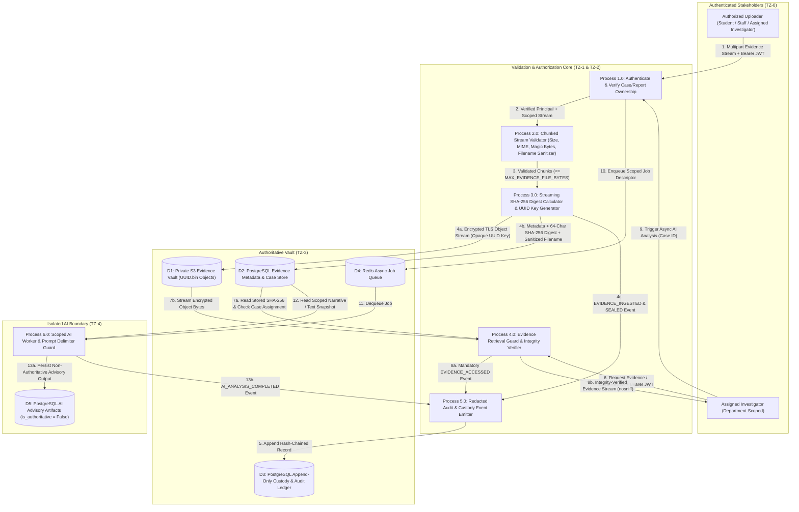
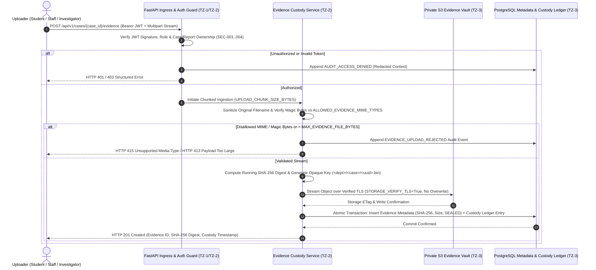

# E-WITNESS — Sensitive Data-Flow Architecture

**Document ID:** `EW-DOC-ARCH-004`  
**Phase:** Phase 03 — System Architecture and Service Boundaries  
**Version:** 1.0.0  
**Status:** Baseline Approved  

---

## 1. Classification of Sensitive Data in E-WITNESS

| Data Class | Classification | Examples | Storage & Transit Protection |
| :--- | :--- | :--- | :--- |
| **DC-1: Cryptographic Secrets & Credentials** | **Restricted / Critical** | `AUTH_SECRET_KEY`, `DATABASE_URL` password, `STORAGE_SECRET_KEY`, `AI_API_KEY`, Bearer JWTs. | Wrapped in `SecretStr`; never committed to Git; never written to logs (`***REDACTED***`); injected via runtime environment. |
| **DC-2: Authoritative Digital Evidence Binaries** | **Highly Confidential / Immutable** | Uploaded PDFs, images, audio/video recordings, text logs attached to incident reports. | Streamed in chunks (`UPLOAD_CHUNK_SIZE_BYTES`); hashed with `SHA-256`; stored under UUID keys in private S3 over TLS; never modified in place. |
| **DC-3: Case Narratives & Investigation Records** | **Confidential (Tenant & Role Scoped)** | Witness statements, reporter identity, investigator notes, formal findings. | Scoped by `department_id` and `case_id` assignment; internal notes stripped from submitter responses (`FR-006`). |
| **DC-4: Chain-of-Custody & Security Audit Ledger** | **High Integrity / Append-Only** | Evidence access events, authentication/authorization logs, break-glass events. | Append-only PostgreSQL storage (`INSERT`/`SELECT` only); SHA-256 hash-chained; secrets redacted prior to persistence. |
| **DC-5: AI Advisory Artifacts** | **Confidential / Non-Authoritative** | Generated case summaries, extracted timelines, entity indexes. | Clearly labeled `is_authoritative = False`; stored separately from primary evidence; includes model/prompt provenance. |

---

## 2. Data-Flow Diagram (DFD): Sensitive Evidence Lifecycle

The following Mermaid Data-Flow Diagram traces how sensitive digital evidence flows through E-WITNESS from initial upload to authorized investigative retrieval and isolated AI analysis.



---

## 3. Sequence Diagram: Evidence Upload, Hashing, and Custody Sealing



---

## 4. Sequence Diagram: Authorized Evidence Retrieval and Integrity Verification

```mermaid
sequenceDiagram
    autonumber
    actor Inv as Assigned Investigator
    participant API as FastAPI Auth & ABAC Guard (TZ-2)
    participant Svc as Evidence Custody Service (TZ-2)
    participant DB as PostgreSQL (Tenant Repo & Custody Ledger)
    participant S3 as Private S3 Evidence Vault (TZ-3)

    Inv->>API: GET /api/v1/cases/{case_id}/evidence/{evidence_id}/download
    API->>DB: Query Case Assignment & Evidence Metadata (WHERE department_id = :dept_id)
    alt Not Assigned or Cross-Department Request
        API->>DB: Append SECURITY_UNAUTHORIZED_EVIDENCE_ACCESS
        API-->>Inv: HTTP 403 Forbidden
    else Explicitly Assigned Investigator
        API->>Svc: Authorize Retrieval (Principal, Evidence Metadata)
        Svc->>S3: Open Encrypted Object Stream (<dept>/<case>/<evidence_uuid>.bin)
        Svc->>Svc: Verify Stream SHA-256 Digest Against Authoritative DB Digest (EVI-003)
        alt SHA-256 Mismatch Detected
            Svc->>DB: Append CRITICAL EVIDENCE_INTEGRITY_VIOLATION Event
            Svc-->>Inv: HTTP 500 Integrity Verification Failure Alert
        else SHA-256 Verified
            Svc->>DB: Append EVIDENCE_DOWNLOADED Custody & Audit Event (AUD-002, EVI-004)
            Svc-->>Inv: Stream Bytes (Content-Disposition: attachment; X-Content-Type-Options: nosniff)
        end
    end
```

---

## 5. Data Protection Invariants Across All Flows

1. **Zero Secret Persistence in Logs or Errors**:
   - Before any log message, configuration summary, or exception traceback leaves `TZ-2`, `redact_text()`, `redact_url()`, and `redact_mapping()` in [`backend/app/core/secrets.py`](file:///c:/Users/lenovo/Desktop/E-WITNESS/backend/app/core/secrets.py) replace credentials, DSN passwords, bearer tokens, and secret keys with `***REDACTED***`.
2. **Zero Unscoped Database Queries**:
   - Data flows from `TZ-2` to `TZ-3` always carry the authenticated principal's `department_id` (and `user_id` for `Student`/`Staff`/`Investigator`).
3. **Strict Separation of Authoritative vs. Advisory Data**:
   - Flow `13a` in the DFD writes strictly to `D5` (`ai_advisory_artifacts`) and has zero write path to `D1` (S3 Evidence Vault) or `D2` (Authoritative Evidence & Case Metadata).
