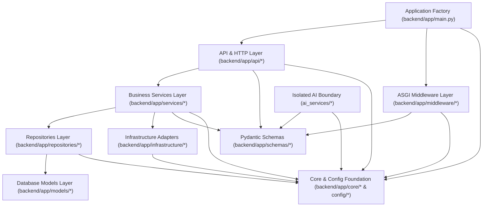

# E-WITNESS — Layered Architecture and Dependency Direction

**Document ID:** `EW-DOC-ARCH-006`  
**Phase:** Phase 07 — Layered Architecture and Coding Standards  
**Version:** 1.0.0  
**Status:** Implemented & Enforced via Automated AST Checks  

---

## 1. Overview

E-WITNESS enforces a strict **Unidirectional Layered Architecture** across `backend/app/` and `ai_services/`. Architectural rules are not merely advisory documentation: they are codified and verified automatically on every test run via the AST analyzer in [`backend/app/core/architecture.py`](file:///c:/Users/lenovo/Desktop/E-WITNESS/backend/app/core/architecture.py).

---

## 2. Layer Responsibilities and Dependency Matrix

### 2.1 Allowed vs. Forbidden Imports (`LAYER_FORBIDDEN_IMPORTS`)

| Layer | Package Path | Permitted Internal Dependencies | Explicitly Forbidden Dependencies (`ARCH-LAYER-IMPORT`) |
| :--- | :--- | :--- | :--- |
| **API & HTTP** | `backend/app/api/` | `services`, `schemas`, `config`, `core`, `fastapi`, `starlette` | `backend.app.models`, `backend.app.repositories`, `sqlalchemy` |
| **ASGI Middleware** | `backend/app/middleware/` | `schemas`, `config`, `core`, `starlette.types` | `backend.app.models`, `backend.app.repositories`, `backend.app.services`, `sqlalchemy` |
| **Business Services** | `backend/app/services/` | `repositories`, `infrastructure`, `schemas`, `config`, `core` | `fastapi`, `starlette`, `backend.app.api`, `backend.app.middleware` |
| **Repositories** | `backend/app/repositories/` | `models`, `config`, `core`, `sqlalchemy` | `fastapi`, `starlette`, `backend.app.api`, `backend.app.services`, `backend.app.schemas`, `backend.app.middleware` |
| **Database Models** | `backend/app/models/` | `config`, `core`, `sqlalchemy` | `fastapi`, `starlette`, `backend.app.api`, `backend.app.services`, `backend.app.repositories`, `backend.app.schemas`, `backend.app.middleware` |
| **Schemas (DTOs)** | `backend/app/schemas/` | `config`, `core`, `pydantic` | `fastapi`, `starlette`, `sqlalchemy`, `api`, `services`, `repositories`, `models`, `infrastructure`, `middleware` |
| **Infrastructure** | `backend/app/infrastructure/` | `config`, `core` | `fastapi`, `starlette`, `backend.app.api`, `backend.app.services`, `backend.app.schemas`, `backend.app.middleware` |
| **Config & Core** | `backend/app/config/`, `backend/app/core/` | Standard library, `pydantic`, `pydantic_settings` | All upper layers (`api`, `services`, `repositories`, `models`, `schemas`, `infrastructure`, `middleware`, `ai_services`), `fastapi`, `starlette`, `sqlalchemy` |
| **AI Services** | `ai_services/` | `schemas`, `config`, `core` | `fastapi`, `starlette`, `sqlalchemy`, `backend.app.api`, `backend.app.repositories`, `backend.app.models`, `backend.app.middleware` |

---

## 3. Key Architectural Enforcement Rules

### 3.1 Separation of HTTP Concerns from Business Logic
- **Rule**: Business services (`backend/app/services/`) must never import `fastapi` or `starlette`, inspect raw `Request` headers, or raise `fastapi.HTTPException`.
- **Implementation**: Services accept typed domain objects or validated DTOs and raise pure domain exceptions inheriting from [`AppError`](file:///c:/Users/lenovo/Desktop/E-WITNESS/backend/app/core/exceptions.py#L13-L34) (`ResourceNotFoundError`, `ConflictError`, `BusinessRuleError`, `AuthenticationError`, `PermissionDeniedError`, `PayloadTooLargeError`, `ServiceUnavailableError`).
- **Translation**: [`backend/app/api/errors.py`](file:///c:/Users/lenovo/Desktop/E-WITNESS/backend/app/api/errors.py) intercepts `AppError` instances at the HTTP boundary and serializes them into the standardized [`ErrorResponse`](file:///c:/Users/lenovo/Desktop/E-WITNESS/backend/app/schemas/common.py#L48-L53) JSON envelope.

### 3.2 Keeping Database Queries Out of API Route Handlers
- **Rule**: Route controllers (`backend/app/api/`) must never import `sqlalchemy`, `backend.app.models`, or `backend.app.repositories`.
- **Implementation**: Route controllers delegate all business operations to injected service classes (e.g., [`HealthServiceDep`](file:///c:/Users/lenovo/Desktop/E-WITNESS/backend/app/api/dependencies.py#L51)). Services coordinate repository calls and transaction boundaries.

### 3.3 Request Validation vs. Business Validation
- **Request Validation (Syntactic & Structural)**: Enforced at the API ingress layer by Pydantic v2 schemas (`backend/app/schemas/`) and FastAPI path/query/body validators. Failures return `HTTP 422` (`code="REQUEST_VALIDATION_ERROR"`).
- **Business Validation (Domain Invariants & State Transitions)**: Enforced inside `backend/app/services/` (e.g., verifying case assignment, department membership, or workflow state transitions). Failures raise `BusinessRuleError` (`422`), `ConflictError` (`409`), or `PermissionDeniedError` (`403`).

### 3.4 Pragmatic Repository Interfaces
- Rather than creating redundant 1-to-1 abstract classes for every table, E-WITNESS defines structural `Protocol` contracts in [`backend/app/repositories/base.py`](file:///c:/Users/lenovo/Desktop/E-WITNESS/backend/app/repositories/base.py) where they enforce critical security invariants:
  - [`TenantScopedRepositoryProtocol`](file:///c:/Users/lenovo/Desktop/E-WITNESS/backend/app/repositories/base.py#L22-L41): Requires keyword-only `department_id: UUID` on entity reads and listings (`SEC-002`).
  - [`AppendOnlyLedgerRepositoryProtocol`](file:///c:/Users/lenovo/Desktop/E-WITNESS/backend/app/repositories/base.py#L45-L58): Exposes `append()` and scoped read methods only—omitting `update()` and `delete()` (`AUD-001`, `EVI-004`).

### 3.5 Controlled Access to Configuration and Secrets (`ARCH-SEC-ENV`)
- Only `backend/app/config/` is permitted to read `os.environ` or `os.getenv`.
- All other modules receive configuration via [`Settings`](file:///c:/Users/lenovo/Desktop/E-WITNESS/backend/app/config/settings.py#L112-L645) injected through FastAPI dependencies ([`SettingsDep`](file:///c:/Users/lenovo/Desktop/E-WITNESS/backend/app/api/dependencies.py#L36)).
- Any direct `os.environ` or `os.getenv` usage outside `backend/app/config/` is flagged as an `ARCH-SEC-ENV` violation by `scan_project_architecture()`.

---

## 4. Request Tracing and Distributed Tracing Readiness (Phase 08)

1. **Incoming Correlation Policy**:
   - [`RequestTracingMiddleware`](file:///c:/Users/lenovo/Desktop/E-WITNESS/backend/app/middleware/request_context.py#L38-L98) inspects the `X-Request-ID` request header.
   - An incoming value is accepted **only** if it matches `^[A-Za-z0-9._-]{8,64}$` ([`is_valid_correlation_id`](file:///c:/Users/lenovo/Desktop/E-WITNESS/backend/app/core/context.py#L23-L28)). Missing, short, oversized ($>64$ chars), or malformed values (e.g., containing spaces, CR/LF newlines, or control characters) are discarded and replaced with a fresh `UUIDv4`.
2. **Context Isolation & Cleanup**:
   - The effective `request_id` is stored in a `contextvars.ContextVar` (`_request_id_ctx`) and reset via its `Token` inside a `finally:` block so concurrent async requests never leak correlation state.
3. **Future Distributed Tracing Readiness**:
   - Note: E-WITNESS does **not** claim an active OpenTelemetry collector, Jaeger, or Zipkin deployment in Phases 06–10. However, by propagating `request_id` via `contextvars` and attaching `X-Request-ID` to all responses and structured JSON logs, the correlation ID can be directly bridged to W3C `traceparent` spans and background worker task payloads in future observability phases.
