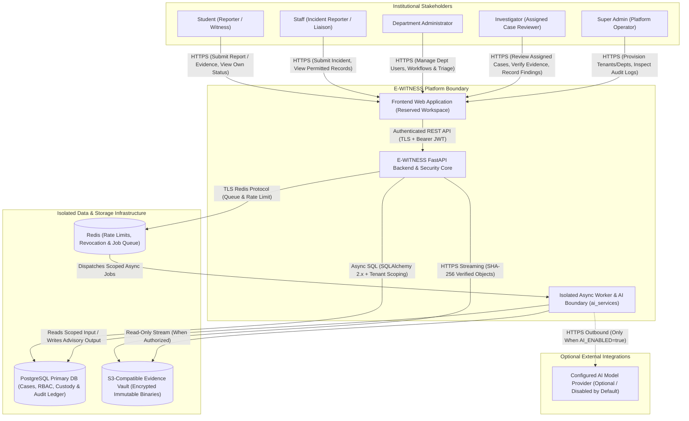
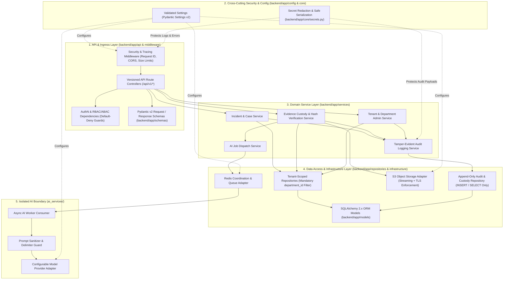

# E-WITNESS — System Architecture and Service Boundaries

**Document ID:** `EW-DOC-ARCH-001`  
**Phase:** Phase 03 — System Architecture and Service Boundaries  
**Version:** 1.0.0  
**Status:** Baseline Approved  

---

## 1. Architectural Overview

E-WITNESS is architected as a **security-first, modular layered backend** with **strict service boundaries**, **multi-department tenant isolation**, **cryptographically verifiable digital evidence storage**, and an **isolated asynchronous AI advisory boundary**.

Every component is designed around four non-negotiable invariants:
1. **Default-Deny & Server-Enforced Authorization**: No client input or frontend route state is trusted. Every operation is authenticated and authorized at the API dependency, domain service, and database repository layers.
2. **Authoritative Evidence Immutability**: Primary digital evidence binaries are hashed (`SHA-256`) on streaming intake, stored under opaque keys in isolated S3-compatible object storage, and linked to an append-only custody and audit trail.
3. **Hard Multi-Department Isolation**: Users and administrators in one department cannot query, enumerate, or mutate records belonging to another department.
4. **Non-Authoritative, Isolated AI Execution**: AI processing runs asynchronously in an isolated worker boundary (`ai_services/`), never executes during application startup, never directly queries raw database tables, and stores outputs strictly as secondary advisory artifacts.

---

## 2. Technology Baseline and Engineering Justification

| Layer / Concern | Selected Technology | Version Baseline | Architectural Justification |
| :--- | :--- | :--- | :--- |
| **Language Runtime** | Python | `3.12+` (Verified on `3.13.1`) | Modern typing (`TypeAlias`, `Self`, strict generics), high async I/O performance, and rich cryptographic/security ecosystem. |
| **Web / API Framework** | FastAPI | `0.135.x` | Native ASGI async concurrency, dependency-injection security guards, automatic OpenAPI schema generation, and tight Pydantic v2 integration. |
| **Validation & Config** | Pydantic v2 & Pydantic Settings | `2.12.x` / `2.13.x` | Rust-backed (`pydantic-core`) strict schema validation, `SecretStr` encapsulation, and fail-fast startup environment validation. |
| **ORM & Database Access** | SQLAlchemy 2.x (Async) | `2.0.x` | Explicit 2.0 typed query syntax (`select()`), non-blocking async session management, and repository pattern compatibility. |
| **Database Migrations** | Alembic | `1.18.x` | Deterministic, version-controlled schema evolution and repeatable migration auditing. |
| **ASGI Server** | Uvicorn | `0.42.x` | High-performance ASGI server with configurable timeouts, worker management, and graceful shutdown hooks. |
| **Primary Relational Store** | PostgreSQL | `15+` (Target) | Strong ACID transactions for case/custody metadata, native UUID support, `JSONB` for structured audit context, and Row-Level Security (RLS) capabilities. |
| **Cache & Coordination** | Redis | `7+` (Target) | Low-latency token revocation/denylist checks, rate-limiting counters, and asynchronous task queue coordination. |
| **Evidence Object Store** | S3-Compatible Object Storage | AWS S3 / MinIO | Decouples multi-megabyte immutable binary evidence from relational tables; supports server-side encryption, object locking (WORM), and streaming I/O. |
| **Isolated AI Services** | `ai_services/` Package | Custom Boundary | Decouples LLM/ML provider adapters from core domain logic; supports provider-agnostic configuration and zero startup coupling. |

> [!NOTE]
> In accordance with Phase 03 execution rules, external infrastructure services (PostgreSQL, Redis, S3 storage, message brokers) are defined architecturally and configured via validated settings in Phase 05, without installing or running unrequested background daemons on the host machine.

---

## 3. System Context Diagram

The following Mermaid diagram illustrates how the five stakeholder roles and external infrastructure systems interact with the E-WITNESS platform boundary.

---

## 4. Container and Layered Component Diagram

Inside the `backend/` and `ai_services/` workspaces, components adhere to a strict unidirectional dependency graph:

---

## 5. Service Responsibilities and Boundary Enforcement

| Boundary | Package Location | Primary Responsibilities | Security & Isolation Controls |
| :--- | :--- | :--- | :--- |
| **1. API & Request Validation** | `backend/app/api/`, `backend/app/schemas/`, `backend/app/middleware/` | Terminate HTTP requests, enforce payload size ceilings (`MAX_REQUEST_BODY_BYTES`), validate path/query/body schemas via Pydantic v2, and serialize filtered response DTOs. | Rejects unknown/unvalidated fields; never returns ORM models directly; strips internal fields (`investigator_notes`) from submitter-facing response schemas. |
| **2. Authentication & Authorization** | `backend/app/core/`, `backend/app/api/` | Verify cryptographic JWT signatures against pinned algorithms (`AUTH_ALGORITHM`), extract principal identity (`user_id`, `role`, `department_id`), and enforce RBAC + ABAC rules. | Enforces default-deny (`SEC-001`); verifies both role permission and resource ownership/assignment before invoking business services. |
| **3. Business Services** | `backend/app/services/` | Orchestrate domain workflows (report intake, case triage, investigator assignment, findings disposition), enforce state-machine transition rules, and emit mandatory audit events. | Enforces cross-entity invariants (e.g., an Investigator can only be assigned to a case within their own department); coordinates atomic unit-of-work transactions. |
| **4. Database Access** | `backend/app/repositories/`, `backend/app/models/` | Execute parameterized asynchronous SQLAlchemy 2.x queries against PostgreSQL; encapsulate persistence details behind repository interfaces. | Base tenant repositories require `department_id` (and `user_id` where applicable) on every query method, preventing accidental unscoped `SELECT` queries (`SEC-002`). |
| **5. Evidence Storage** | `backend/app/infrastructure/`, `backend/app/services/` | Validate uploaded file streams (size, MIME allowlist, magic bytes), compute streaming `SHA-256` digests, generate randomized UUID storage keys, and stream objects to/from S3 storage over TLS. | Never exposes public bucket URLs or raw storage credentials; blocks overwrite operations (`EVI-002`); enforces `STORAGE_VERIFY_TLS=True` (`SEC-007`). |
| **6. AI Processing** | `ai_services/` | Execute asynchronous, non-authoritative tasks (summarization, timeline extraction) using explicit input snapshots and structured output schemas. | Disabled by default (`AI_ENABLED=False`); zero startup calls (`AI_CONNECT_ON_STARTUP=False`); zero direct write access to authoritative evidence or case tables; wraps untrusted text in strict delimiters. |
| **7. Background Jobs** | `backend/app/infrastructure/`, `ai_services/` | Offload long-running or retryable operations (AI analysis, retention archiving, export package building) from ASGI HTTP worker threads via Redis-backed queues. | Jobs carry explicit correlation IDs, principal attribution, and scoped resource IDs; worker failures are isolated from synchronous API availability (`NFR-002`). |
| **8. Audit Logging** | `backend/app/services/`, `backend/app/repositories/` | Record immutable, timestamped, hash-chained security and custody events across all authentication, authorization, case, evidence, and administrative actions. | Repository exposes `append()` and scoped `query()` methods only—no `update()` or `delete()` methods exist (`AUD-001`); all payloads pass through `redact_mapping()` (`AUD-005`). |
| **9. External Integrations** | `backend/app/infrastructure/`, `ai_services/` | Encapsulate all outbound network calls (S3 storage, Redis, optional AI provider APIs) behind typed adapter interfaces with strict timeouts (`HTTP_TIMEOUT_SECONDS`, `STORAGE_TIMEOUT_SECONDS`). | Enforces outbound TLS verification, bounded retries, circuit-breaking timeouts, and credential redaction on connection errors. |

---

## 6. Evidence Security and Custody Architecture

> [!IMPORTANT]
> **Roadmap Transparency**: Phases 01–05 define the evidence security architecture and implement the validated configuration guardrails (`MAX_EVIDENCE_FILE_BYTES`, `UPLOAD_CHUNK_SIZE_BYTES`, `ALLOWED_EVIDENCE_MIME_TYPES`, `STORAGE_*` settings). Full database models, streaming S3 adapters, and chain-of-custody ledgers are scheduled for **Phases 46–65** of the master roadmap.

### 6.1 Planned Controls and Roadmap Mapping
1. **Evidence Ownership & Authorization Checks (Phases 21–25, 46–50)**:
   - Uploads are permitted only when the authenticated principal is the report creator (`Student`/`Staff`) on an active intake or an explicitly assigned `Investigator` on the target case.
2. **Safe File Handling & Ingestion Pipeline (Phases 46–50)**:
   - Incoming uploads are read in bounded chunks (`UPLOAD_CHUNK_SIZE_BYTES = 1 MB` default) up to `MAX_EVIDENCE_FILE_BYTES` (50 MB default).
   - Both the declared `Content-Type` header and the file's leading magic bytes must match `ALLOWED_EVIDENCE_MIME_TYPES`.
   - User-supplied filenames are stripped of path components and control characters; the object is stored in S3 under an opaque key: `<department_uuid>/<case_uuid>/<evidence_uuid>.bin`.
3. **Cryptographic Integrity Verification (`SHA-256`) (Phases 48–52, 56–60)**:
   - While streaming chunks during upload, a running `hashlib.sha256()` digest is computed.
   - The resulting 64-character hex digest and exact byte size are recorded immutably in PostgreSQL before the upload transaction commits.
   - Upon retrieval, the storage adapter verifies the stream digest against the recorded `SHA-256` hash (`EVI-003`).
4. **Controlled Object Storage & Restricted Retrieval (Phases 51–60)**:
   - S3 buckets remain strictly private.
   - Retrieval requests hit an authenticated FastAPI endpoint that verifies case assignment/ownership, appends an `EVIDENCE_ACCESSED` event to the custody ledger, and streams the file with `Content-Disposition: attachment` and `X-Content-Type-Options: nosniff`.
5. **Retention, Legal Hold, and Immutability (Phases 61–65, 76–80)**:
   - Evidence records support a boolean `legal_hold` flag (`EVI-008`) that overrides automated retention expiration.
   - Application database roles and repositories omit `DELETE` and binary-overwrite operations on sealed evidence.
6. **Separation of AI Analysis from Authoritative Evidence (Phases 81–95)**:
   - AI workers never mutate `evidence_items` or object storage binaries. AI outputs are persisted in a separate `ai_advisory_artifacts` table with `is_authoritative = False` and mandatory model/prompt provenance metadata.

---

## 7. Multi-Department and Tenant Isolation Model

E-WITNESS implements a **Defense-in-Depth Shared-Schema Multi-Department Isolation Model**:

1. **Token & Principal Binding**:
   - Every authenticated user (except platform-level `Super Admin`) is bound to an explicit `department_id` (UUID).
2. **API Dependency Enforcement Point**:
   - FastAPI security dependencies extract the authenticated principal's `role` and `department_id` from the verified security context—never trusting a `department_id` passed in a client query parameter or JSON body to elevate scope.
3. **Service-Layer ABAC Enforcement Point**:
   - Domain services verify role-specific relational rules (e.g., for `ROLE_INVESTIGATOR`, verifying an active row in `case_assignments` matching `(case_id, investigator_user_id, department_id)`).
4. **Repository-Layer Mandatory Scoping**:
   - All multi-tenant repositories require `department_id: UUID` as a mandatory parameter on `get_by_id()`, `list()`, and `update()` methods, embedding `WHERE department_id = :department_id` into every generated SQL statement.
5. **Database-Level Safeguards (PostgreSQL RLS & Composite Foreign Keys)**:
   - Multi-tenant child tables (`cases`, `evidence_items`, `investigation_notes`, `case_assignments`) include `department_id` alongside parent foreign keys (`(case_id, department_id)`) so cross-department foreign key references are structurally impossible at the relational constraint level, reinforced by PostgreSQL Row-Level Security (RLS) session variables (`app.current_department_id`).
