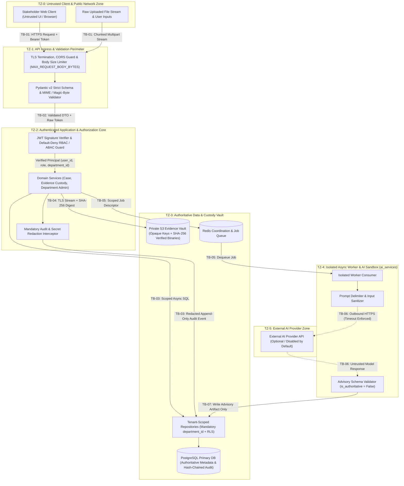

# E-WITNESS — Trust Boundaries and Security Zones

**Document ID:** `EW-DOC-ARCH-003`  
**Phase:** Phase 03 — System Architecture and Service Boundaries  
**Version:** 1.0.0  
**Status:** Baseline Approved  

---

## 1. Trust Zone Definitions

E-WITNESS partitions all runtime components, networks, and external actors into six distinct **Trust Zones** (`TZ-0` through `TZ-5`). Every data transfer or invocation that crosses a boundary between two zones must pass through an explicit **Policy Enforcement Point (PEP)** and **Input Validation Gate**.

| Zone ID | Trust Zone Name | Resident Components / Actors | Trust Level | Primary Security Assumptions |
| :--- | :--- | :--- | :--- | :--- |
| `TZ-0` | **Untrusted Client & Public Zone** | Web browsers (`Student`, `Staff`, `Dept Admin`, `Investigator`, `Super Admin`), unauthenticated callers, uploaded raw file streams. | **Untrusted (0%)** | All headers, tokens, query parameters, JSON payloads, filenames, and file binaries originating here may be malicious, spoofed, or malformed. |
| `TZ-1` | **API Ingress & Validation Perimeter** | Reverse proxy / TLS terminator, FastAPI ASGI middleware, CORS filter, payload size limiter, Pydantic v2 request schema validators. | **Low / Perimeter** | Terminates transport encryption; enforces structural validity and size limits before any domain logic or database query executes. |
| `TZ-2` | **Authenticated Application & Authorization Core** | AuthN/RBAC/ABAC dependency guards, domain services (`backend/app/services/`), secret redaction utilities (`backend/app/core/`). | **High (Scoped)** | Operates only on verified `Principal` contexts (`user_id`, `role`, `department_id`) and validated DTOs; enforces tenant isolation and state rules. |
| `TZ-3` | **Authoritative Data & Custody Vault** | Tenant-scoped repositories, append-only audit/custody repositories, PostgreSQL primary database, private S3-compatible evidence object storage, Redis coordination store. | **Critical / Authoritative** | Accessible strictly from `TZ-2` (and scoped worker adapters in `TZ-4`) over authenticated TLS connections; enforces relational constraints, RLS, and object immutability. |
| `TZ-4` | **Isolated Async Worker & AI Execution Sandbox** | Background worker processes, `ai_services/` adapters, prompt sanitization/delimiter guards. | **Restricted / Non-Authoritative** | Cannot accept direct external network traffic; processes only queued job descriptors; writes only to non-authoritative advisory tables (`ai_advisory_artifacts`). |
| `TZ-5` | **External Model Provider Zone** | Optional third-party or external LLM/AI API endpoints (`openai`, `anthropic`, `gemini`). | **Untrusted External** | Treated as an external untrusted network boundary; receives only task-scoped, delimited text over TLS (`STORAGE_VERIFY_TLS=True`); all responses are treated as untrusted text requiring schema validation. |

---

## 2. Trust Boundary Architecture Diagram

---

## 3. Trust Boundary Crossing Controls (`TB-01` – `TB-07`)

| Boundary ID | Crossing Path | Threats Mitigated | Mandatory Security Controls |
| :--- | :--- | :--- | :--- |
| **`TB-01`** | `TZ-0` $\rightarrow$ `TZ-1` (Client to Ingress Perimeter) | Payload DoS, Cross-Origin CSRF/Data Theft, Malicious File Upload, Path Traversal | 1. Enforce HTTPS/TLS in production. 2. Enforce strict `CORS_ALLOWED_ORIGINS` (reject `*` and `http://` in production). 3. Enforce `MAX_REQUEST_BODY_BYTES` and `MAX_EVIDENCE_FILE_BYTES` via chunked streaming. 4. Strip path components from filenames and verify file magic bytes against `ALLOWED_EVIDENCE_MIME_TYPES`. |
| **`TB-02`** | `TZ-1` $\rightarrow$ `TZ-2` (Perimeter to Application Core) | Spoofing, Broken Function/Object Level Authorization (BOLA/IDOR), Privilege Escalation | 1. Verify JWT signature using pinned `AUTH_ALGORITHM` allowlist (`none` rejected). 2. Verify token expiration (`exp`), issuer (`iss`), and audience (`aud`). 3. Evaluate role (`RBAC`) and resource ownership/assignment (`ABAC`) before entering service methods. 4. Log all `401`/`403` denials via the audit emitter. |
| **`TB-03`** | `TZ-2` $\rightarrow$ `TZ-3` (Application Core to PostgreSQL) | Cross-Department Data Leakage, SQL Injection, Audit Log Tampering | 1. Parameterized SQLAlchemy 2.x async queries only (zero string-concatenated SQL). 2. Mandatory `department_id` parameter in repository signatures + PostgreSQL RLS policies. 3. Append-only audit repository with `redact_mapping()` pre-filter and SHA-256 hash chaining. |
| **`TB-04`** | `TZ-2` $\rightarrow$ `TZ-3` (Application Core to S3 Evidence Vault) | Evidence Tampering, Unauthorized Bucket Access, MITM Interception | 1. Mandatory TLS (`STORAGE_USE_SSL=True` in prod) and certificate verification (`STORAGE_VERIFY_TLS=True` always). 2. Compute streaming `SHA-256` before/during upload and verify against stored digest on retrieval. 3. Use randomized UUID object keys (`<dept_uuid>/<case_uuid>/<evidence_uuid>.bin`) with overwrite protection. |
| **`TB-05`** | `TZ-2` $\rightarrow$ `TZ-4` via Redis (Core to Isolated Worker) | Queue Poisoning, Unscoped Background Access, Synchronous Thread Starvation | 1. Authenticate and encrypt Redis connections (`rediss://` required in production). 2. Queue payloads contain only immutable UUID references (`case_id`, `department_id`, `requester_id`) and correlation IDs—never raw secrets. 3. Worker re-verifies case/department state before processing. |
| **`TB-06`** | `TZ-4` $\leftrightarrow$ `TZ-5` (Isolated Worker to External AI Provider) | Prompt Injection, Sensitive Data Exfiltration, Provider Hanging/Failure | 1. Disabled by default (`AI_ENABLED=False`) and prohibited at startup (`AI_CONNECT_ON_STARTUP=False`). 2. Enforce strict `AI_REQUEST_TIMEOUT_SECONDS` and token limits (`AI_MAX_TOKENS`). 3. Wrap untrusted report/evidence text inside explicit system delimiters. 4. Redact API keys (`AI_API_KEY`) from all error logs and exceptions. |
| **`TB-07`** | `TZ-4` $\rightarrow$ `TZ-3` (AI Output Persistence) | Corruption of Authoritative Evidence, Unattributed AI Hallucinations | 1. Validate model output against strict Pydantic schema. 2. Persist strictly to `ai_advisory_artifacts` (`is_authoritative=False`) with model/prompt provenance. 3. Prohibit AI worker from updating `cases`, `evidence_items`, or `investigation_findings`. |
